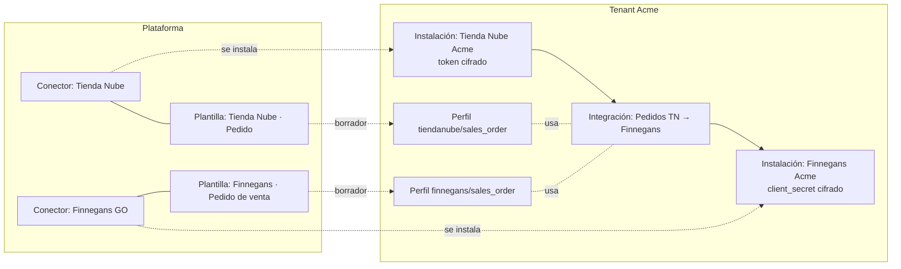
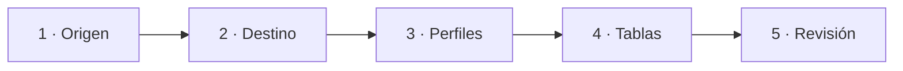

# Guía de integración del frontend con el Maestro de Conectores

**Para:** el equipo que desarrolla el frontend de M-Connect (repositorio aparte).
**Qué cubre:** cómo construir las pantallas de conectores, instalaciones, plantillas de mapping y el asistente para crear integraciones con el Maestro de Conectores unificado, y qué cambia respecto de lo que el frontend usa hoy.
**Fuente de verdad:** los ejemplos de esta guía salen de respuestas reales de la API, con IDs acortados (`…`). Además, `tests/integration/test_frontend_contract_connectors.py` falla si cambia la forma de esas respuestas. El contrato completo y actualizado está en `GET /openapi.json` (disponible en desarrollo y staging; en producción está deshabilitado).

---

## Índice

1. [Lo que cambia para el frontend actual](#1-lo-que-cambia-para-el-frontend-actual)
2. [Conceptos](#2-conceptos)
3. [Convenciones](#3-convenciones)
4. [Flujos](#4-flujos)
   - [4.1 Catálogo de conectores](#41-catálogo-de-conectores)
   - [4.2 Instalar un conector](#42-instalar-un-conector)
   - [4.3 Editar o borrar una instalación](#43-editar-o-borrar-una-instalación)
   - [4.4 Asistente para crear una integración](#44-asistente-para-crear-una-integración)
   - [4.5 Crear un perfil desde una plantilla](#45-crear-un-perfil-desde-una-plantilla)
   - [4.6 Estado de una integración (readiness)](#46-estado-de-una-integración-readiness)
   - [4.7 Conectores propios del tenant (avanzado)](#47-conectores-propios-del-tenant-avanzado)
   - [4.8 Consola de plataforma (superadmin)](#48-consola-de-plataforma-superadmin)
5. [Qué mostrar según el rol](#5-qué-mostrar-según-el-rol)
6. [Catálogo de errores](#6-catálogo-de-errores)
7. [Rutas deprecadas](#7-rutas-deprecadas)
8. [Checklist de implementación](#8-checklist-de-implementación)
9. [Referencia de endpoints](#9-referencia-de-endpoints)

---

## 1. Lo que cambia para el frontend actual

Antes había conectores en varios lugares: dos catálogos en `/metadata`, Finnegans configurado aparte y la configuración de cada conector escrita a mano dentro del `config` de la integración, con las contraseñas incluidas. Ahora hay **una sola lista de conectores** (`GET /connector-definitions`) y todo lo demás sale de ahí.

| Hoy el frontend… | Ahora | Qué hacer |
|---|---|---|
| Arma el selector de conectores con `GET /metadata/connector-types` o `GET /metadata/connectors`. | Los conectores salen de la base: `GET /connector-definitions` (Finnegans GO, Tienda Nube, Persat, REST genérico, archivo, API, SQL, webhook…). Las dos rutas de `/metadata` quedan **deprecadas**. | Usar `GET /connector-definitions?kind=input` / `?kind=output` ([4.1](#41-catálogo-de-conectores)). |
| Crea la integración con `connector_type` + `config`, con URLs y tokens adentro. | El body nuevo tiene `source` y `output`, y cada bloque apunta a una **instalación**. El body viejo sigue funcionando un tiempo (la API lo convierte), pero responde con headers `Deprecation`. | Migrar al body nuevo ([4.4](#44-asistente-para-crear-una-integración)). |
| Escribe los campos del conector "a mano" en un JSON. | Cada conector trae sus formularios ya calculados: `installation_form` (cuenta/conexión) e `integration_form` (lo propio de cada flujo). | Renderizar los formularios a partir de esos campos ([3.2](#32-cómo-renderizar-un-formulario)). |
| Carga credenciales Finnegans con `PUT /tenants/{id}/finnegans-credentials` o `PUT /integrations/{id}/finnegans-credentials`. | Las credenciales viven **solo** en la instalación del conector, cifradas. Las rutas viejas son alias **deprecados**. | Instalar el conector "Finnegans GO" ([4.2](#42-instalar-un-conector)). |
| Elige el documento de Finnegans con `finnegans_document` en el `config`. | Es un campo del `integration_form` de Finnegans: `output.config.document` (`pedido_venta` \| `punto_venta`). | Mostrarlo como un select en el paso de destino del asistente. |
| Supone que los mapping profiles de Finnegans ya existen (los sembraba un script con datos de prueba). | Ya no se crea ningún perfil automáticamente. El usuario crea cada perfil **desde cero o partiendo de una plantilla**: la API devuelve un borrador y el perfil recién existe cuando el usuario lo guarda. | Agregar el paso "Perfiles" con el botón **Usar plantilla** ([4.5](#45-crear-un-perfil-desde-una-plantilla)). |
| No tiene forma de saber qué le falta a una integración. | `GET /integrations/{id}/readiness` devuelve un checklist (conector de entrada, perfiles, destino y tablas) y sugiere plantillas. | Usarlo como último paso del asistente y como indicador en el listado ([4.6](#46-estado-de-una-integración-readiness)). |
| Cualquier OPERATOR podía crear o editar conexiones con credenciales. | Crear, editar y borrar **instalaciones** es solo para **ADMIN**, y queda en la auditoría. Las integraciones las sigue armando un OPERATOR sobre instalaciones existentes. | Ocultar el alta y la edición de instalaciones a OPERATOR y VIEWER ([5](#5-qué-mostrar-según-el-rol)). |

**Lo que no cambia:** login y tokens, `POST /profiles` (solo agrega `template_id`, opcional), `/lookup-tables`, `/executions`, `/runs`, `POST /integrations/{id}/trigger` y `POST /integrations/{id}/run`.

**Integraciones existentes:** el backend las migra con un script en el deploy. Después del deploy, `GET /integrations` ya las devuelve con `source` y `output`. No hace falta que el frontend las convierta.

---

## 2. Conceptos

| Concepto | Qué es | Ejemplo | Quién lo crea |
|---|---|---|---|
| **Conector** | Algo a lo que M-Connect sabe conectarse. Es la única lista que ve el usuario. | "Finnegans GO", "Tienda Nube (pull por API)", "Persat (webhook)" | La plataforma (públicos). Un tenant puede crear los suyos (privados), solo sobre REST o API. |
| **Instalación** | La cuenta o conexión del tenant en un conector: URL, usuario y credenciales (cifradas). | "Finnegans Acme" con el `client_id` y `client_secret` de Acme | ADMIN del tenant |
| **Integración** | Un flujo de datos: de la instalación de **entrada** (`source`) a la instalación de **salida** (`output`). | "Pedidos Tienda Nube → Finnegans" | OPERATOR o ADMIN |
| **Mapping profile** | Cómo se transforman los datos: de entrada (origen → canónico) y de salida (canónico → destino). Se busca por `source_system` + entidad. | `tiendanube/sales_order`, `finnegans/sales_order` | OPERATOR o ADMIN, siempre por acción explícita |
| **Plantilla** | Punto de partida para crear un perfil. Pertenece a un conector y **no crea nada** al abrirla. | "Finnegans · Pedido de venta" | La plataforma |
| **Driver** | El protocolo técnico que hay detrás de un conector (REST, SQL, webhook, API de Finnegans). Al usuario normalmente no se le muestra. | `rest`, `finnegans`, `webhook` | El equipo de backend |



**Dónde se completa cada campo.** Cada campo de configuración se completa en uno de tres lugares:

- **El conector** lo deja fijo. Por ejemplo, la URL de Tienda Nube o los endpoints de Finnegans. El usuario no lo ve.
- **La instalación** lo completa una vez por cuenta: la URL propia, el usuario y las credenciales. Va en `installation_form`.
- **Cada integración** lo completa por flujo: el endpoint a consultar, la query SQL o el documento de Finnegans. Va en `integration_form`.

---

## 3. Convenciones

### 3.1 Errores de configuración (422 con `loc` por campo)

Los errores de configuración de un conector usan la misma forma que los 422 de validación de FastAPI. `loc` indica dónde marcar el error en la pantalla:

```json
{
  "detail": [
    {
      "loc": ["body", "config", "client_secret"],
      "msg": "Es un secreto: va en secrets (se guarda cifrado).",
      "type": "connector_config"
    }
  ]
}
```

| `loc` empieza con… | Dónde está el error |
|---|---|
| `["body", "config", <campo…>]` | Campo no secreto del formulario de instalación |
| `["body", "secrets", <campo…>]` | Campo secreto del formulario de instalación |
| `["body", "source" \| "output", "config", <campo…>]` | Campo del `integration_form` en ese paso del asistente |
| `["body", "source" \| "output", "installation_id"]` | La instalación elegida no sirve (no existe, está desactivada, es del lado equivocado o le falta un campo) |
| `["body", "source" \| "output"]` | Problema del bloque en general (ej: Finnegans necesita `document` para `sales_order`) |

Un nombre de campo con punto (`fetch.auth_token`) llega partido en `loc`: `["body", "secrets", "fetch", "auth_token"]`.

### 3.2 Cómo renderizar un formulario

Cada campo de `installation_form` o `integration_form` tiene esta forma:

```json
{ "name": "client_secret", "type": "string", "required": true, "secret": true,
  "description": "Client secret de la cuenta Finnegans." }
```

| `type` | Control sugerido |
|---|---|
| `string` con `secret: false` | Input de texto |
| `string` con `secret: true` | Input de contraseña. Va en `secrets`, nunca en `config` |
| `int` | Input numérico |
| `bool` | Checkbox o switch |
| `enum:a\|b\|c` | Select con las opciones `a`, `b` y `c` |
| `list` | Input de etiquetas (lista de strings) |
| `dict` | Editor de pares clave/valor (ej: `headers`) |

- **Nombres con punto** (`fetch.base_url`, `fetch.auth_token`): agrupar los campos bajo un título ("Hidratación (fetch)"). Se pueden enviar con punto (`{"fetch.base_url": "…"}`) o anidados (`{"fetch": {"base_url": "…"}}`). La API acepta las dos formas y siempre devuelve la anidada.
- `required: true` significa que el campo es obligatorio para que el conector funcione. Si falta, la API responde 422.
- Usar `description` como ayuda o tooltip.

### 3.3 Los secretos nunca vuelven

Las respuestas no incluyen los valores secretos. En su lugar traen `secret_fields`: la lista de nombres de los secretos que ya están cargados. Al editar, mostrar el campo como "•••• (cargado)" y enviarlo solo si el usuario lo cambia ([4.3](#43-editar-o-borrar-una-instalación)).

---

## 4. Flujos

### 4.1 Catálogo de conectores

`GET /connector-definitions?kind=input|output` (cualquier rol). Devuelve los conectores públicos y los privados del tenant, solo los activos. Para ver también los desactivados: `?include_inactive=true`.

```json
{
  "id": "44335f9f-…",
  "owner_tenant_id": null,
  "visibility": "public",
  "code": "finnegans",
  "name": "Finnegans GO",
  "driver": "finnegans",
  "kind": "output",
  "description": "ERP Finnegans GO. Clientes, productos y ventas (Pedido de Venta o Punto de Venta). Cada tenant instala su propia cuenta (client_id / client_secret).",
  "is_active": true,
  "active_version": {
    "id": "85c205e6-…",
    "version": "1.0.0",
    "installation_form": [
      { "name": "client_id", "type": "string", "required": true, "secret": false, "description": "Client ID de la cuenta Finnegans." },
      { "name": "client_secret", "type": "string", "required": true, "secret": true, "description": "Client secret de la cuenta Finnegans." },
      { "name": "base_url", "type": "string", "required": false, "secret": false, "description": "URL base de la API (default: la pública de Finnegans)." }
    ],
    "integration_form": [
      { "name": "document", "type": "enum:pedido_venta|punto_venta", "required": false, "secret": false, "description": "Documento de venta para sales_order (opciones en el spec: documents)." }
    ]
  },
  "created_at": "2026-10-05T15:03:45",
  "updated_at": "2026-10-05T15:03:45"
}
```

- Usar `code` como clave estable (por ejemplo, para elegir el ícono). `name` es solo una etiqueta y puede cambiar.
- Si `active_version` es `null`, el conector todavía no se publicó y no se puede instalar: mostrarlo deshabilitado.
- En una tarjeta del catálogo conviene mostrar `name`, `description` y, si el tenant ya tiene instalaciones de ese conector, cuántas (`GET /connector-installations?connector_definition_id={id}`).

### 4.2 Instalar un conector

`POST /connector-installations` (**solo ADMIN**). El body tiene dos bolsas que siguen el `installation_form`: `config` lleva los campos con `secret: false` y `secrets` los campos con `secret: true`.

```http
POST /connector-installations
{
  "name": "Finnegans Acme",
  "connector_definition_id": "44335f9f-…",
  "config":  { "client_id": "acme-client" },
  "secrets": { "client_secret": "s3cr3t" }
}
```

Respuesta `201`:

```json
{
  "id": "c169ebd8-…",
  "tenant_id": "e22deb51-…",
  "definition_version_id": "85c205e6-…",
  "version": "1.0.0",
  "connector": { "id": "44335f9f-…", "code": "finnegans", "name": "Finnegans GO", "kind": "output", "driver": "finnegans" },
  "name": "Finnegans Acme",
  "config": { "client_id": "acme-client" },
  "secret_fields": ["client_secret"],
  "integration_form": [
    { "name": "document", "type": "enum:pedido_venta|punto_venta", "required": false, "secret": false, "description": "Documento de venta para sales_order (opciones en el spec: documents)." }
  ],
  "is_active": true,
  "created_at": "2026-10-05T15:03:47",
  "updated_at": "2026-10-05T15:03:47"
}
```

- Con `connector_definition_id`, la instalación queda fijada a la versión activa del conector. Si después se publica una versión nueva, esta instalación **no cambia**.
- `name` es único dentro del tenant (409 si se repite). Conviene sugerir el nombre del conector más el de la empresa.
- Errores típicos: un secreto enviado en `config`, un campo de integración enviado en la instalación o un campo obligatorio faltante. Los tres responden 422 con `loc` ([3.1](#31-errores-de-configuración-422-con-loc-por-campo)).
- La respuesta trae el `integration_form` para que el asistente sepa qué preguntar cuando el usuario elija esta instalación.

**Ejemplos de lo que pide cada conector del catálogo**

| Conector (`code`) | `installation_form` | `integration_form` |
|---|---|---|
| `finnegans` | `client_id`, `client_secret`, `base_url` | `document` |
| `tiendanube` | `api_key` (con el formato `bearer <token>`), `headers` (con `User-Agent`), entre otros | `endpoint` (con el `store_id`) y otros opcionales |
| `tiendanube_webhook` | `secret`, `fetch.api_key`, `fetch.headers`, entre otros | `fetch.endpoint`, `data_path` y otros |
| `persat` | `secret` (`whsec_…`) | `id_path` y los campos `fetch.*`, todos opcionales |
| `rest` | `base_url`, auth y `host_allowlist` | `endpoint`, `method` |
| `file_output` | `directory` | `format`, `write_mode`, `filename_template`… |
| `api` / `db` / `file_input` / `webhook` | Conexión y credenciales | Lo propio de cada flujo |

No hace falta hardcodear esta tabla: la respuesta del conector trae los formularios exactos.

### 4.3 Editar o borrar una instalación

`PATCH /connector-installations/{id}` (**solo ADMIN**). `config` y `secrets` **se combinan con lo que ya está guardado**:

- Una clave enviada reemplaza su valor.
- Una clave con valor `null` se borra.
- Las claves que no se envían quedan como estaban.

```http
PATCH /connector-installations/c169ebd8-…
{ "secrets": { "client_secret": "nuevo" } }
```

Así se puede cambiar un solo secreto sin conocer ni reenviar los demás. Para cambiar de `auth_type: basic` a `none` sin dejar la contraseña guardada:

```json
{ "config": { "auth_type": "none", "basic_user": null }, "secrets": { "basic_password": null } }
```

**Borrar.** `DELETE /connector-installations/{id}` (**solo ADMIN**) responde 409 si alguna integración usa la instalación:

```json
{ "detail": "La instalación está en uso por: 'Pedidos TN → Finnegans' (output). Cambiá esas integraciones o desactivá la instalación (PATCH is_active=false)." }
```

Antes de mostrar el botón "Borrar", consultar `GET /connector-installations/{id}/usage`:

```json
[ { "integration_id": "d2da598a-…", "name": "Pedidos TN → Finnegans", "role": "output" } ]
```

Si la lista no está vacía, ofrecer "Desactivar" en lugar de "Borrar". Una instalación desactivada hace fallar las entregas de las integraciones que la usan, y ese error se ve en `/executions`.

### 4.4 Asistente para crear una integración

Pasos recomendados:



**Paso 1 · Origen.** El usuario elige:

1. La entidad canónica (`GET /metadata/entity-types`).
2. Un conector de entrada (`GET /connector-definitions?kind=input`).
3. Una instalación de ese conector (`GET /connector-installations?connector_definition_id=…`). Si no hay ninguna, un ADMIN puede crearla ahí mismo; un OPERATOR ve el mensaje "Pedile a un administrador que instale el conector".
4. El `source_system`: el nombre que identifica al origen y que elige el perfil de entrada (ej: `tiendanube`). Si hay plantillas de entrada para ese conector, sugerir su `source_system`.
5. Los campos del `integration_form` de la instalación.

**Paso 2 · Destino.** Igual que el paso anterior, con `kind=output`. Para Finnegans, el `integration_form` pide `document`. Para `sales_order` hay que elegirlo; si no, la API responde 422. El `source_system` de salida elige el perfil de salida. Para Finnegans, sugerir el de la plantilla (`finnegans` para Pedido de venta, `finnegans_punto_venta` para Punto de venta).

**Crear la integración:**

```http
POST /integrations
{
  "name": "Pedidos TN → Finnegans",
  "source_entity": "sales_order",
  "schedule": "*/15 * * * *",
  "source": {
    "installation_id": "b79bd52a-…",
    "source_system": "tiendanube",
    "config": { "endpoint": "/2025-03/123456/orders?payment_status=paid" }
  },
  "output": {
    "installation_id": "c169ebd8-…",
    "source_system": "finnegans",
    "config": { "document": "pedido_venta" }
  }
}
```

Respuesta `201`. `connector_type` lo deriva la API y no se envía. `config` repite `source` y `output` por compatibilidad: leer siempre `source` y `output`.

```json
{
  "id": "d2da598a-…",
  "tenant_id": "e22deb51-…",
  "name": "Pedidos TN → Finnegans",
  "connector_type": "api",
  "source_entity": "sales_order",
  "source": { "installation_id": "b79bd52a-…", "source_system": "tiendanube", "config": { "endpoint": "/2025-03/123456/orders?payment_status=paid" } },
  "output": { "installation_id": "c169ebd8-…", "source_system": "finnegans", "config": { "document": "pedido_venta" } },
  "config": { "source": { "…": "…" }, "output": { "…": "…" } },
  "schedule": "*/15 * * * *",
  "is_active": true,
  "created_at": "2026-10-05T15:03:48",
  "updated_at": "2026-10-05T15:03:48",
  "last_run_at": null, "next_run_at": null, "last_run_status": null, "last_run_stats": null
}
```

Si falta el documento de Finnegans:

```json
{ "detail": [ { "loc": ["body", "output"], "msg": "Finnegans: elegí el documento de venta (`document`) para 'sales_order'. Opciones: ['pedido_venta', 'punto_venta'].", "type": "connector_config" } ] }
```

- `output` es opcional al crear la integración: se puede guardar el origen y completar el destino después. Mientras no tenga destino, readiness la marca como incompleta y las entregas fallan con `output_not_declared`. No hay destino por defecto.
- **Editar:** `PATCH /integrations/{id}` con `source` y/o `output`. Cada bloque se reemplaza completo. `"output": null` quita el destino; `source` no se puede quitar. Si cambia `source_entity`, la API vuelve a validar los bloques.
- **Paso 3 · Perfiles** y **Paso 4 · Tablas**: ver [4.5](#45-crear-un-perfil-desde-una-plantilla).
- **Paso 5 · Revisión:** `GET /integrations/{id}/readiness` ([4.6](#46-estado-de-una-integración-readiness)).

### 4.5 Crear un perfil desde una plantilla

**Regla:** pedir una plantilla **no crea nada**. El usuario siempre ve y edita el borrador antes de guardar.

1. **Listar las plantillas que aplican** (cualquier rol):

   ```http
   GET /mapping-templates?connector_definition_id=44335f9f-…&entity=sales_order&direction=outbound
   ```

   ```json
   [
     {
       "id": "5ce2de9f-…",
       "connector_definition_id": "44335f9f-…",
       "connector_code": "finnegans",
       "connector_name": "Finnegans GO",
       "code": "pedido_venta",
       "direction": "outbound",
       "entity": "sales_order",
       "name": "Finnegans · Pedido de venta",
       "description": "Canónico SalesOrder → POST /api/pedidoVenta (documento previo a la facturación). Usar con output.config.document = 'pedido_venta'. …",
       "version": "1.0.0",
       "source_system": "finnegans",
       "is_active": true,
       "updated_at": "2026-10-05T15:03:45"
     }
   ]
   ```

   `direction` es `inbound` para el perfil de entrada (origen → canónico) y `outbound` para el de salida (canónico → destino). Si no hay plantillas, ofrecer solo **Crear desde cero**.

2. **Abrir una plantilla:** `GET /mapping-templates/{id}`. Además de lo anterior, trae:

   ```json
   {
     "profile_draft": {
       "source_system": "finnegans",
       "entity": "sales_order",
       "version": "1.0.0",
       "config": [
         { "source_field": "external_id", "target_field": "IdentificacionExterna", "field_type": "simple", "on_error": "fail", "description": null },
         { "source_field": "currency", "target_field": "MonedaCodigo", "field_type": "lookup", "on_error": "default", "description": null, "lookup_table_code": "FinnegansMonedaMap", "default_value": "PES" },
         { "source_field": "external_id", "target_field": "EmpresaCodigo", "field_type": "constant", "on_error": "fail", "description": null, "value": "1" }
       ],
       "is_active": true,
       "template_id": "5ce2de9f-…"
     },
     "placeholders": [
       { "target_field": "EmpresaCodigo", "parent": null, "hint": "Código de tu empresa en Finnegans (/Empresa/list)." },
       { "target_field": "CondicionPagoCodigo", "parent": null, "hint": "Condición de pago (/CondicionPago/list)." }
     ],
     "required_lookups": [
       {
         "code": "FinnegansMonedaMap",
         "description": "Moneda canónica (ISO) → código de Moneda en Finnegans (/Moneda/list).",
         "example_entries": { "ARS": "PES", "USD": "DOL" },
         "exists_in_tenant": false,
         "lookup_draft": {
           "codigo": "FinnegansMonedaMap",
           "name": "Moneda canónica (ISO) → código de Moneda en Finnegans (/Moneda/list).",
           "is_active": true,
           "entries": { "ARS": "PES", "USD": "DOL" }
         }
       }
     ]
   }
   ```

   (`config` está recortado en el ejemplo.)

3. **Cargar `profile_draft` en el editor de perfiles tal cual.** Tiene la forma exacta del body de `POST /profiles`.
   - Marcar en el editor los mappers de `placeholders` (por su `target_field`; si `parent` no es `null`, el mapper está dentro de los `sub_mappings` de ese padre) y mostrar el `hint`. Son valores de ejemplo que el usuario **tiene** que reemplazar por los de su empresa.
   - Al guardar, `POST /profiles` con el borrador editado. `template_id` queda registrado y la respuesta trae `template_id` y `template_version`, para mostrar "Creado desde: Finnegans · Pedido de venta v1.0.0".

4. **Tablas que necesita el perfil** (`required_lookups`):
   - `exists_in_tenant: true`: el tenant ya tiene la tabla y no hay nada que hacer.
   - `exists_in_tenant: false`: ofrecer **Crear tabla** con `lookup_draft` precargado en el formulario de `POST /lookup-tables`. Las `entries` son de **ejemplo**: el usuario las revisa antes de guardar. La API exige al menos una entrada.

**Crear desde cero:** el editor vacío de siempre y `POST /profiles` sin `template_id`. No cambió nada.

> El perfil es una **copia**: si la plataforma actualiza la plantilla, los perfiles creados antes no cambian.

### 4.6 Estado de una integración (readiness)

`GET /integrations/{id}/readiness` (cualquier rol) revisa todo lo que la integración necesita para funcionar, sin ejecutar nada:

```json
{
  "integration_id": "d2da598a-…",
  "ready": false,
  "checks": [
    { "key": "source", "ok": true, "detail": "Tienda Nube (pull por API) · Tienda Nube Acme", "problems": [], "templates": [], "missing": [] },
    { "key": "inbound_profile", "ok": false,
      "detail": "No hay perfil activo para tiendanube/sales_order. Crealo desde cero o partiendo de una plantilla (GET /mapping-templates/{id} → POST /profiles).",
      "problems": [],
      "templates": [ { "id": "78af3d44-…", "code": "tiendanube_pedido", "name": "Tienda Nube · Pedido", "source_system": "tiendanube" } ],
      "missing": [] },
    { "key": "output", "ok": true, "detail": "Finnegans GO · Finnegans Acme", "problems": [], "templates": [], "missing": [] },
    { "key": "outbound_profile", "ok": false,
      "detail": "No hay perfil activo para finnegans/sales_order. …",
      "problems": [],
      "templates": [ { "id": "5ce2de9f-…", "code": "pedido_venta", "name": "Finnegans · Pedido de venta", "source_system": "finnegans" } ],
      "missing": [] },
    { "key": "references", "ok": true, "detail": null, "problems": [], "templates": [], "missing": [] }
  ]
}
```

| `key` | Qué revisa | Qué ofrecer cuando `ok` es `false` |
|---|---|---|
| `source` | La instalación de entrada existe, está activa y su config es válida | Mostrar `problems` (cada uno con `field` y `msg`); llevar a editar la integración o la instalación |
| `inbound_profile` | Hay un perfil activo para `source.source_system` y la entidad | Un botón por plantilla de `templates` (→ [4.5](#45-crear-un-perfil-desde-una-plantilla)) y **Crear desde cero** |
| `output` | Hay destino declarado, con instalación utilizable | Llevar al paso 2 del asistente |
| `outbound_profile` | Igual que `inbound_profile`, para `output.source_system` | Igual que `inbound_profile` |
| `references` | Las tablas de lookup y datasets que usan los perfiles existen | `missing` trae `lookup:<codigo>` o `dataset:<codigo>`: llevar a crearlas |

Los checks llegan siempre en ese orden. Uso sugerido: como último paso del asistente y como indicador "Lista / Incompleta" en el listado de integraciones (se puede pedir solo para las integraciones visibles en pantalla).

### 4.7 Conectores propios del tenant (avanzado)

Un OPERATOR o ADMIN puede crear un conector **privado** sobre los drivers que lo permiten. `GET /metadata/connector-drivers` los marca con `tenant_definable: true`; hoy son `rest` (salida) y `api` (entrada).

1. `POST /connector-definitions` con `{ "name", "driver", "kind", "description" }`. Responde 403 si se intenta `visibility: public` y 422 si el driver no es `tenant_definable`.
2. `POST /connector-definitions/{id}/versions` con `{ "version": "1.0.0", "spec": { … } }`. El `spec` fija campos (por ejemplo `base_url`, `endpoint`, `auth_type`) y **nunca lleva secretos** (422). Para armar el formulario del spec, usar `config_fields` de `GET /metadata/connector-drivers`: cada campo trae su `scope`.
3. `POST /connector-definitions/{id}/versions/{version_id}/publish`. Desde ese momento el conector aparece en `GET /connector-definitions` con sus formularios, igual que uno público.

Es una pantalla de uso poco frecuente. Puede quedar para una segunda etapa.

### 4.8 Consola de plataforma (superadmin)

Los conectores públicos y las plantillas los administra el superadmin, sin sesión de soporte porque es catálogo de la plataforma y no datos de un tenant:

- `GET/POST/PATCH/DELETE /platform/connector-definitions` (`POST` pide `code`, `name`, `driver`, `kind`), más `…/versions` y `…/versions/{version_id}/publish`.
- `GET/POST/PATCH/DELETE /platform/mapping-templates`.

El catálogo base también se publica desde el repositorio del backend en cada deploy (`scripts/seed_platform_catalog.py`). Las pantallas de consola son opcionales; si no se construyen, el catálogo se mantiene desde el repositorio.

---

## 5. Qué mostrar según el rol

| Acción | VIEWER | OPERATOR | ADMIN | Soporte `read_only` | Soporte `full` |
|---|---|---|---|---|---|
| Ver conectores, instalaciones (sin secretos), plantillas y readiness | ✓ | ✓ | ✓ | ✓ | ✓ |
| Crear, editar o borrar instalaciones (credenciales) | — | — | ✓ | — | ✓ (auditado) |
| Crear o editar integraciones y perfiles; crear desde plantilla | — | ✓ | ✓ | — | ✓ |
| Borrar integraciones | — | — | ✓ | — | ✓ |
| Crear conectores privados | — | ✓ | ✓ | — | ✓ |
| Borrar conectores privados | — | — | ✓ | — | ✓ |
| Catálogo de plataforma (`/platform/connector-definitions`, `/platform/mapping-templates`) | — | — | — | Superadmin, sin sesión de soporte | Superadmin, sin sesión de soporte |

El rol es el del tenant activo (`/users/me`), como en el resto de la API.

---

## 6. Catálogo de errores

| Código | Cuándo | Qué mostrar |
|---|---|---|
| 403 | Un tenant intenta crear un conector público, o un rol sin permiso usa una acción | El `detail` de la respuesta |
| 404 | Conector, instalación o plantilla inexistente o de otro tenant | "No encontrado" |
| 409 | Instalación en uso (`DELETE`); conector sin versión publicada o desactivado; nombre o `code` repetido; versión que no es draft al publicar | El `detail`, que explica qué hacer |
| 422 (`type: connector_config`) | Config de instalación o de integración inválida | Marcar el campo indicado por `loc` ([3.1](#31-errores-de-configuración-422-con-loc-por-campo)) |
| 422 (`detail` string) | Body deprecado que no se pudo convertir (ej: Finnegans sin credenciales) | El `detail` |

**Errores en tiempo de ejecución** (se ven en `GET /executions/{trace_id}/logs`, columna `event`):

| `event` | Causa | Cómo se corrige |
|---|---|---|
| `output_not_declared` | La integración no tiene destino (`output`) | Completar el paso 2 del asistente |
| `output_config_error` | Falta `output.source_system` | Editar la integración |
| `output_installation_error` | La instalación de salida no existe, está desactivada, no es de salida o su config no sirve para la entidad (ej: falta `document`) | Editar la instalación o la integración |
| `outbound_profile_not_found` | No hay perfil de salida para `output.source_system` + entidad | Crear el perfil ([4.5](#45-crear-un-perfil-desde-una-plantilla)) |

---

## 7. Rutas deprecadas

Siguen funcionando, pero responden con los headers `Deprecation` y `Link` (el reemplazo). Cuando se acuerde una fecha de retiro, también llevarán `Sunset`. Cada uso queda registrado como `deprecated_route_used`: cuando ese evento deje de aparecer, el backend las elimina. **Avisar al backend cuando el frontend termine de migrar.**

| Deprecado | Reemplazo |
|---|---|
| `GET /metadata/connector-types` | `GET /connector-definitions?kind=input` |
| `GET /metadata/connectors` | `GET /metadata/connector-drivers` (drivers) o `GET /connector-definitions` (conectores) |
| `PUT/GET /tenants/{id}/finnegans-credentials` | `POST`/`PATCH`/`GET /connector-installations…` del conector `finnegans`. Mientras tanto, el alias opera sobre la **única** instalación Finnegans del tenant: la crea si no hay y responde 409 si hay más de una. |
| `PUT /integrations/{id}/finnegans-credentials` | `PATCH /connector-installations/{id}`. El alias actualiza la instalación de salida de la integración si solo ella la usa; si la comparte, le crea una propia. |
| Body de `POST`/`PATCH /integrations` con `connector_type` + `config` | Body con `source`/`output`. El body viejo se convierte (crea las instalaciones necesarias y cifra los secretos) y responde con `Deprecation`. |

La fecha de retiro la fija el backend con `LEGACY_CONNECTOR_ROUTES_SUNSET` y se anuncia en el header `Sunset`.

---

## 8. Checklist de implementación

- [ ] Reemplazar los selectores de `/metadata/connector-types` y `/metadata/connectors` por `GET /connector-definitions?kind=…`.
- [ ] Componente genérico de formulario a partir de `installation_form` / `integration_form`: tipos, secretos, nombres con punto, `required` y `description`.
- [ ] Mapear los 422 con `loc` a los campos del formulario.
- [ ] Pantalla de instalaciones: listar, crear (ADMIN), editar con PATCH parcial (secretos como "•••• cargado"), desactivar y borrar (consultando antes `/usage`).
- [ ] Asistente de integración: origen → destino → perfiles → tablas → revisión, enviando `source`/`output`.
- [ ] Select de `document` para Finnegans (viene en el `integration_form`).
- [ ] Botón **Usar plantilla** en el editor de perfiles: cargar `profile_draft`, resaltar `placeholders` y guardar con `POST /profiles`.
- [ ] Crear las tablas faltantes desde `required_lookups[].lookup_draft`.
- [ ] Indicador de readiness en el listado de integraciones y en el último paso del asistente.
- [ ] Ocultar el alta y la edición de instalaciones a OPERATOR y VIEWER.
- [ ] Dejar de usar `/finnegans-credentials` y el body `connector_type` + `config`, y avisar al backend.

---

## 9. Referencia de endpoints

| Método | Ruta | Rol | Descripción |
|---|---|---|---|
| GET | `/connector-definitions` | Cualquiera | Conectores disponibles (`?kind`, `?include_inactive`) |
| GET | `/connector-definitions/{id}` | Cualquiera | Conector con sus formularios |
| POST | `/connector-definitions` | OPERATOR+ | Crear conector privado |
| PATCH | `/connector-definitions/{id}` | OPERATOR+ | Editar conector privado propio |
| DELETE | `/connector-definitions/{id}` | ADMIN | Borrar conector privado sin instalaciones |
| POST | `/connector-definitions/{id}/versions` | OPERATOR+ | Crear versión (draft) |
| GET | `/connector-definitions/{id}/versions` | Cualquiera | Listar versiones |
| POST | `/connector-definitions/{id}/versions/{version_id}/publish` | OPERATOR+ | Publicar una versión |
| GET | `/connector-installations` | Cualquiera | Instalaciones del tenant (`?kind`, `?connector_definition_id`) |
| GET | `/connector-installations/{id}` | Cualquiera | Detalle (sin secretos) |
| GET | `/connector-installations/{id}/usage` | Cualquiera | Integraciones que la usan |
| POST | `/connector-installations` | ADMIN | Instalar un conector |
| PATCH | `/connector-installations/{id}` | ADMIN | Editar (combina `config`/`secrets` con lo guardado; `null` borra) |
| DELETE | `/connector-installations/{id}` | ADMIN | Borrar (409 si está en uso) |
| GET | `/mapping-templates` | Cualquiera | Plantillas (`?connector_definition_id`, `?entity`, `?direction`, `?source_system`) |
| GET | `/mapping-templates/{id}` | Cualquiera | Plantilla con `profile_draft` y `lookup_draft` |
| POST | `/profiles` | OPERATOR+ | Crear perfil (opcional: `template_id`) |
| POST | `/integrations` | OPERATOR+ | Crear integración (`source`/`output`) |
| PATCH | `/integrations/{id}` | OPERATOR+ | Editar (bloques completos; `"output": null` quita el destino) |
| GET | `/integrations/{id}/readiness` | Cualquiera | Checklist de lo que falta |
| GET | `/metadata/connector-drivers` | Autenticado | Drivers con el `scope` de cada campo |
| * | `/platform/connector-definitions…` | Superadmin | Conectores públicos y sus versiones |
| * | `/platform/mapping-templates…` | Superadmin | Plantillas |
